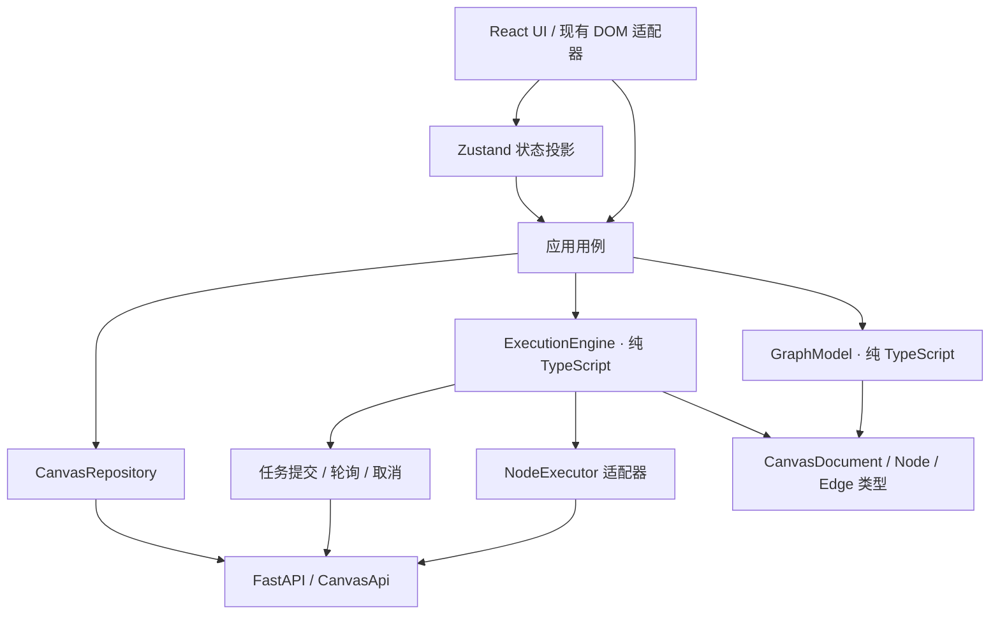

# Infinite Canvas 前端架构渐进式重构计划书

> 版本：1.0（提案）  
> 编制日期：2026-08-12  
> 适用范围：经典画布优先，智能画布后续复用  
> 推荐技术栈：Vite + TypeScript + React + Zustand + Vitest + Playwright  
> 核心策略：先抽离业务内核，再迁移界面；全程双路径可回退，不做一次性重写

## 1. 执行摘要

本项目适合采用“绞杀者式渐进重构”，不适合直接把现有页面整体改写为 React，也不适合立刻替换为 React Flow。

推荐方案如下：

1. 保持 FastAPI 接口、画布数据和现有静态页面可用。
2. 引入 Vite、TypeScript 和前端测试工具链，与旧脚本并存。
3. 首先从 `canvas.js` 中抽出纯 TypeScript 的 `GraphModel` 和 `ExecutionEngine`。
4. 用适配器复用现有节点执行函数和后端 API，不在第一阶段重写所有节点。
5. 用 Zustand 明确文档状态、会话状态和执行状态的所有权。
6. React 从运行状态栏、错误提示、属性面板等局部“岛屿”开始接管 UI。
7. 节点 UI 按类型分批迁移；画布渲染层是否采用 `@xyflow/react`，在真实原型和性能对比后再决定。
8. 经典画布稳定后，再评估与智能画布共用领域层和基础设施层，不强行合并两套产品交互。

在“两名前端工程师 + 半职 QA + 后端按需支持”的假设下：

- 核心可靠性重构预计 7～9 个日历周。
- 完成主要 React UI 迁移预计累计 13～17 个日历周。
- 若决定替换画布渲染层，另增加约 3～5 周。
- 单人执行通常需要 20～28 周，不建议以一个长期大分支完成。

## 2. 当前架构基线

以下数据来自 2026-08-12 的仓库快照。

| 项目 | 当前规模/事实 | 架构含义 |
|---|---:|---|
| `static/js/canvas.js` | 14,638 行，约 694 KiB | 状态、渲染、事件、执行、轮询、保存高度耦合 |
| `static/js/smart-canvas.js` | 14,361 行，约 711 KiB | 存在第二套大型画布实现，部分职责重复 |
| `static/js/ltx-director-timeline.js` | 4,111 行 | 专用编辑器已具备独立模块雏形 |
| `static/js/canvas-core.js` | 138 行 | 已证明共享纯工具可以逐步抽离 |
| `static/js/canvas-api.js` | 418 行 | 已存在 API 门面，是迁移基础设施层的天然接缝 |
| 应用自有 JavaScript | 12 个文件，42,828 行，约 2.0 MiB | 迁移范围较大，必须分阶段 |
| `canvas.js` 顶层函数 | 约 799 个 | 缺少模块边界和明确依赖方向 |
| `canvas.js` 顶层 `let` 声明 | 约 129 个 | 共享可变状态多，并发与状态污染风险高 |
| DOM/全局耦合 | 197 处 `window.`、80 次 `innerHTML` 写入、155 个事件监听 | 业务状态与浏览器生命周期直接耦合 |
| 异步调度点 | 31 次 `setTimeout`/`setInterval` 调用 | 定时器的创建、清理和所有权难以统一验证 |
| HTML 内联事件 | 经典画布约 74 处 | DOM 所有权与事件入口分散，不利于局部接管 |
| 画布 CSS | 经典画布 1,552 行；智能画布 1,140 行 | 可先保留视觉样式，避免 UI 与逻辑同时重写 |
| 构建工具 | 无 `package.json`、Vite、TypeScript 或锁文件 | 需要先建立可重复构建和版本锁定 |
| 页面加载 | HTML 按顺序加载多个全局脚本 | 依赖靠加载顺序隐式建立，无法静态检查 |
| 后端托管 | FastAPI 将 `static/` 直接挂载到 `/static` | Vite 应输出静态资源，不需要 Node 服务端或 SSR |
| 数据模型 | 后端把节点、连线接收为通用字典列表 | 前端需要兼容旧数据并提供运行时边界校验 |
| 自动化测试 | 2 个 Python 测试文件；画布有 8 个源码结构回归测试 | 已覆盖近期漏洞，但缺少真正执行逻辑和浏览器交互测试 |

### 2.1 当前主要问题

1. **状态所有权不明确**：节点、连线、视口、选择、运行和保存状态均由全局变量持有。
2. **业务逻辑依赖 DOM**：拓扑判断、运行调度和错误处理与 `render()`、`alert()`、节点 DOM 更新交织。
3. **异步任务难以推理**：运行、停止、轮询、恢复、重试和并行循环共同修改共享状态。
4. **修改影响面不可见**：全局函数可以直接调用任意状态和 UI，编译器无法验证依赖。
5. **测试层级不足**：当前画布测试主要检查源码中是否包含特定语句，不能证明运行时行为正确。
6. **经典/智能画布重复演进**：两套大脚本分别维护保存、渲染和交互，公共能力无法稳定复用。
7. **发布依赖手工版本号**：HTML 中静态资源使用人工 query string，容易出现缓存和版本不一致。

### 2.2 已具备的有利条件

1. `canvas-core.js` 和 `canvas-api.js` 已经形成初步边界，可以作为适配层继续使用。
2. FastAPI 接口相对集中，首期无需改后端协议。
3. 近期修复已经明确了执行调度的关键不变量，并留下 8 个回归场景。
4. 现有 CSS 和自定义画布渲染可以暂时保留，使逻辑重构与视觉重构解耦。
5. 保存接口已有冲突检测和画布备份能力，可用于灰度与回滚。

## 3. 重构目标与非目标

### 3.1 目标

1. 图结构、运行调度、任务恢复不依赖 DOM 或 React，可以独立单元测试。
2. 每一类状态只有一个写入者，禁止同一状态在旧脚本、React 和 Store 中三方双写。
3. 普通运行、级联运行、并发、停止、失败恢复和重试形成显式状态机。
4. 旧画布数据无需手工迁移即可打开、运行和保存；未知节点字段不得丢失。
5. 新模块全部使用严格 TypeScript，并通过统一构建、测试和类型检查。
6. UI 可以按区域、按节点类型逐步迁移，每一步都能独立发布和回退。
7. 核心能力最终可被经典画布与智能画布共享。

### 3.2 非目标

首轮明确不做以下事项：

- 不重写 FastAPI 后端。
- 不改变画布 API URL 和现有持久化格式。
- 不同步进行视觉设计升级。
- 不立即合并经典画布和智能画布的全部 UI。
- 不立即引入 Next.js、SSR、微前端或复杂事件总线。
- 不在验证前替换为 React Flow。
- 不为了“代码看起来现代”重写稳定且没有业务价值的工具函数。

## 4. 技术决策

### 4.1 推荐技术栈

| 能力 | 选择 | 使用边界 |
|---|---|---|
| 构建与模块 | Vite | 构建画布前端；输出仍由 FastAPI 静态托管 |
| 语言 | TypeScript 严格模式 | 所有新增代码；旧 JS 通过适配器逐步迁移 |
| UI | React | 节点视图、面板、工具栏和状态展示 |
| 客户端状态 | Zustand | React 所需的文档投影、会话状态和执行投影 |
| 领域测试 | Vitest | Graph、Execution、编解码和 Store 测试 |
| 浏览器测试 | Playwright | 连线、运行、停止、重试、保存、恢复等用户流程 |
| 画布渲染 | 首期保留现有实现 | `@xyflow/react` 只做决策原型，不先进入主路径 |
| 服务端资源缓存 | 暂不强制引入 | 配置/模型/素材请求重复复杂后再评估 TanStack Query |
| 运行时数据校验 | 边界最小校验 | 优先复用现有 sanitize；复杂 schema 出现后再决定是否引入 Zod |

### 4.2 为什么不选择其他方案

| 方案 | 结论 | 原因 |
|---|---|---|
| 继续纯 JavaScript 拆文件 | 可作为过渡，不作为终态 | 能降低文件尺寸，但无法解决持久化数据、节点类型和运行上下文的类型安全 |
| 纯 TypeScript，不上 React | 可行备选 | 迁移风险更低，但复杂节点表单和状态 UI 仍需继续手工维护 DOM 生命周期 |
| Vue 3 + Pinia | 架构上同样可行 | 若团队 Vue 能力明显强于 React，可替换 React/Zustand；领域层设计不变 |
| Redux Toolkit | 暂不采用 | 当前主要问题是业务逻辑与状态耦合，不是缺少大型全局事件框架；若以后需要完整事件审计再评估 |
| Next.js | 不采用 | 当前由 FastAPI 提供 API 和静态文件，没有 SSR、SEO 或 Node 服务端需求 |
| 微前端 | 不采用 | 当前不是多个独立团队和独立发布域，额外运行时与治理成本没有收益 |
| 立即使用 React Flow | 暂缓 | 现有画布已有自定义虚拟化、媒体节点、组、裁剪、连线和时间轴行为，直接替换的等价性成本过高 |
| 一次性重写 | 不采用 | 两个核心脚本接近 2.9 万行，且现有浏览器行为测试不足，无法可靠证明功能等价 |

React 官方支持在现有页面中逐个挂载 React 组件，Vite 官方也提供传统后端与构建 manifest 的集成方式，因此该渐进路径不是临时技巧，而是被工具链直接支持的部署模型。

## 5. 目标架构



### 5.1 建议目录结构

```text
frontend/
├─ package.json
├─ package-lock.json
├─ tsconfig.json
├─ vite.config.ts
├─ src/
│  ├─ canvas/
│  │  ├─ domain/
│  │  │  ├─ types.ts
│  │  │  ├─ graph.ts
│  │  │  ├─ execution.ts
│  │  │  └─ document-codec.ts
│  │  ├─ application/
│  │  │  ├─ canvas-controller.ts
│  │  │  └─ execution-controller.ts
│  │  ├─ infrastructure/
│  │  │  ├─ canvas-repository.ts
│  │  │  ├─ task-client.ts
│  │  │  └─ legacy-node-executors.ts
│  │  ├─ stores/
│  │  │  ├─ document-store.ts
│  │  │  ├─ session-store.ts
│  │  │  └─ execution-store.ts
│  │  ├─ ui/
│  │  │  ├─ nodes/
│  │  │  ├─ panels/
│  │  │  └─ toolbar/
│  │  ├─ legacy/
│  │  │  └─ bridge.ts
│  │  └─ main.tsx
│  └─ test/
├─ e2e/
└─ dist/                 # CI 构建产物，不手工编辑
```

目录只表达真实边界。首期不创建空目录、空接口或“未来可能会用”的抽象；模块在迁移到它时再建立。

### 5.2 状态所有权

| 状态 | 唯一所有者 | 是否持久化 | 说明 |
|---|---|---:|---|
| 节点、连线、标题、日志 | Document Store | 是 | 对应 CanvasDocument，保存前统一编码 |
| 选择、视口、展开面板、拖拽 | Session Store | 否/本地 | 不进入服务端文档 |
| 运行队列、锁、轮次、错误、AbortSignal | Execution Engine | 否 | Engine 发事件，Store 只保留 UI 投影 |
| 模型配置、工作流、素材目录 | Infrastructure cache | 否 | 不与画布执行状态混用 |
| Output 与 pending task | Document + Task Adapter | 是 | 明确提交、轮询、恢复和最终落盘时机 |

### 5.3 核心约束

1. `GraphModel` 不访问 `window`、DOM、网络和 Store。
2. `ExecutionEngine` 不调用 `alert()`、`render()` 或直接修改节点对象。
3. 每次运行拥有独立 `RunContext`，包含目标、拓扑快照、循环上下文和取消信号。
4. 节点执行器返回结构化结果或错误，不直接决定后续拓扑。
5. React 组件只调用 action/用例，不直接写全局数组。
6. 保存通过一个 Repository 入口完成，保留当前 409 冲突语义。
7. 解码旧文档时保留未知字段和未知节点类型，禁止“打开即丢数据”。
8. Zustand 不存放 Promise、AbortController、定时器或轮询句柄，只保存可序列化的 UI 投影。

## 6. 迁移方法

采用绞杀者模式：新内核逐步接管旧代码的职责，旧路径在每个里程碑内保留为回退选项。

### 6.1 双路径原则

- 用查询参数、后端配置或本地开发开关启用新路径，例如 `canvas_modern_core`。
- Graph 等无副作用逻辑先运行“影子模式”：新旧结果同时计算，只使用旧结果并记录差异。
- 执行和保存等有副作用逻辑禁止双跑，只允许单一激活路径。
- 每个状态切片只能有一个写入者；桥接层只转换命令和事件，不做长期双向同步。
- 新路径成为默认后，旧路径至少保留两个稳定发布周期，再删除。

### 6.2 数据兼容原则

- 初始 `schemaVersion` 缺失时视为版本 1。
- 使用可辨识节点类型逐步建模，同时保留 `UnknownNode` 回退。
- 编解码必须满足“读取旧数据再保存，不丢未知字段”。
- 第一次由新路径保存前调用现有备份能力创建备份。
- 数据迁移函数必须是纯函数，并用真实匿名化 fixture 做往返测试。

## 7. 分阶段实施计划

### 阶段 0：基线、决策记录和冻结关键行为（3～5 个工作日）

**目标**：在动架构前定义“什么叫功能等价”。

任务：

1. 编写 ADR，确认技术栈、非目标、数据兼容和回退策略。
2. 建立 10～15 份匿名化画布 fixture：线性、分支、汇合、Output 中转、循环、多媒体、失败 pending、旧版本字段。
3. 固化近期 8 个执行漏洞为行为规格。
4. 记录 50/200/500 节点画布的加载、缩放、拖动、连线和内存基线。
5. 确认支持的浏览器、发布方式、Node LTS 和包管理器。

交付物：ADR、fixture、基线报告、验收场景清单。

退出标准：产品、前端、后端和 QA 对功能等价清单签字；所有 fixture 有可恢复备份。

回退：本阶段无运行时代码变更。

### 阶段 1：建立可共存的前端工具链（3～5 个工作日）

**目标**：新增代码可模块化、类型检查、测试和构建，但不改变生产画布行为。

任务：

1. 创建 `frontend/`，引入 Vite、TypeScript、React、Zustand、Vitest。
2. 锁定 Node Active LTS、npm 版本和依赖锁文件。
3. 配置 `typecheck`、`test`、`build`、`e2e` 脚本。
4. 开发环境由 Vite 提供 HMR；生产构建输出至 FastAPI 可托管的 `static/dist/`。
5. 迁移期由现有 HTML 加载一个稳定 bridge entry；最终由 Vite 生成带哈希引用的 HTML。
6. CI 增加安装、类型检查、单测、构建和静态页面 smoke test。

交付物：可重复构建的空桥接 bundle、CI 门禁、开发说明。

退出标准：关闭 bridge 时页面与当前版本完全一致；开启 bridge 时无功能变化；生产环境不需要 Node 进程。

回退：移除一个 script 标签即可回到旧路径。

### 阶段 2：类型、文档编解码和特征测试（5～7 个工作日）

**目标**：定义稳定的数据边界，替代“任意对象到处传递”。

任务：

1. 定义 `CanvasDocument`、`CanvasNode`、`CanvasEdge`、`RunContext`、`TaskRecord` 等最小类型。
2. 实现 `decodeCanvasDocument`、`encodeCanvasDocument` 和版本迁移。
3. 保留未知字段、未知节点与历史 Output 数据。
4. 为现有 `CanvasApi` 建立类型化适配器，不改 API URL。
5. 将现有源码结构测试映射为真正的 TypeScript 行为测试；旧测试在替代测试通过前保留。

交付物：类型包、文档 codec、fixture 往返测试、API adapter。

退出标准：全部 fixture 往返不丢字段；当前后端可读写新 adapter 产生的 payload；没有生产路径切换。

回退：新 codec 仍处于旁路，不影响旧保存。

### 阶段 3：抽离 GraphModel（7～10 个工作日）

**目标**：统一图查询、环检测和拓扑排序。

任务：

1. 抽离上下游查询、Output 中转、终端节点判断、拓扑排序和循环检测。
2. 明确定义非法边、缺失节点、重复边和历史脏数据行为。
3. 使用表驱动测试覆盖线性、分支、汇合、环、Output 中转和未知节点。
4. 影子运行新旧 Graph，比较真实画布上的结果。
5. 逐个替换 `computeCascadeOrder`、`canConnect` 等调用点。

交付物：纯 TypeScript GraphModel、差异日志、调用适配器。

退出标准：fixture 和真实抽样画布的新旧结果一致；环检测及拓扑测试全部通过；浏览器交互无性能退化超过 10%。

回退：功能开关恢复旧 Graph；新 Graph 无副作用，不涉及数据回滚。

### 阶段 4：抽离 ExecutionEngine（10～15 个工作日）

**目标**：把运行、级联、停止、失败和重试变成可测试状态机。

任务：

1. 建立显式运行状态：idle、queued、running、stopping、done、failed、stopped。
2. 实现普通运行、级联运行、下游重试、并行轮次和共享节点占用。
3. 每次运行使用独立 RunContext 和 AbortSignal。
4. 将图片、视频、Comfy、LTX、LLM 等现有执行函数包装成 NodeExecutor adapter。
5. Engine 产生事件，由旧 DOM 适配器更新现有状态栏；首期不迁移节点 UI。
6. 用可控 fake executor 测试成功、失败、停止、超时、恢复和并发交错。
7. 增加 Playwright 主链路，网络请求使用可预测 mock，确保不会真实消费生成额度。

交付物：ExecutionEngine、legacy executors、领域测试和浏览器回归。

退出标准：近期 8 个执行漏洞均有单元测试和至少一条端到端主链覆盖；每次点击产生的外部任务数符合预期；停止后没有遗留调度器。

回退：执行功能开关恢复旧调度器；同一时刻只能启用一个调度器。

### 阶段 5：API、任务恢复和持久化边界（7～10 个工作日）

**目标**：网络和持久化失败不再污染 UI 与领域状态。

任务：

1. 将任务提交、轮询、取消、恢复封装为 Task Client。
2. 将画布读取、保存、409 冲突、备份和远程更新封装为 Canvas Repository。
3. 保留现有 pending task 恢复语义，并明确刷新、停止和关闭页面后的行为。
4. 添加超时、重试上限、AbortSignal 和错误分类。
5. 使用契约测试验证前端 payload 与 FastAPI 当前接口兼容。

交付物：Task Client、Canvas Repository、契约测试、失败恢复说明。

退出标准：断网、409、轮询失败、页面刷新、停止级联场景均有自动化验证；旧文档保存内容无字段损失。

回退：adapter 可切回 `window.CanvasApi` 原调用，后端无需回滚。

#### 中期 Go/No-Go 决策

阶段 5 完成后必须正式复盘一次：

- 如果 Graph、Execution、Persistence 和测试体系已经将可靠性与开发效率提升到目标水平，可以暂停 React 画布迁移，把阶段 6～8 转为按业务收益排期。
- 如果旧 DOM 仍持续造成高维护成本，再进入 React UI 迁移。
- 该决策确保项目目标始终是降低故障和维护成本，而不是为了完成框架替换。

### 阶段 6：建立 Store 并引入 React 岛（8～10 个工作日）

**目标**：先迁移最容易验证、对画布几何影响最小的 UI。

首批建议：

1. 运行状态、进度、错误、重试和停止栏。
2. 画布顶部工具栏和保存状态。
3. 日志/成本面板。
4. 节点属性面板中不影响画布布局的区域。

任务：

1. 建立 Document、Session、Execution 三类 Store。
2. Store 订阅 Engine 事件，React 使用 selector 精确订阅。
3. 旧 DOM 通过 bridge 发送 command，不直接双写 Store。
4. 逐个 React root 挂载，保留旧容器 fallback。

交付物：Zustand stores、首批 React islands、组件测试。

退出标准：React 关闭后旧 UI 仍可运行；React 开启后无双重事件监听；运行状态只由 Engine 投影产生。

回退：按 island 关闭功能开关或卸载 root。

### 阶段 7：CanvasBoard V2 与节点 UI（15～25 个工作日）

**目标**：在独立开关后的 V2 Board 中由 React 完整拥有画布 DOM，避免旧渲染器和 React 同时管理同一节点。

开始前先做 3～5 天渲染层 Spike，比较保留自研交互与采用 `@xyflow/react`；决策门见第 9 节。未通过门禁时继续使用自研画布交互，不影响本阶段继续进行。

实施顺序：

1. V2 Board 外壳：视口、选择、拖动、连线、快捷键和节点注册表。
2. Prompt、PromptGroup、Loop 等低风险节点。
3. Generator、MsGen、Output。
4. Video、Comfy、LLM。
5. LTX Director 和带媒体生命周期的复杂节点。

迁移期间，生产默认仍使用完整 Legacy Board；V2 只在内部开关下运行。禁止在同一个节点 DOM 中混合 React 事件和旧事件处理。每批节点都必须：

- 使用同一 Domain 类型和 Store action。
- 保留当前 CSS、尺寸和数据契约。
- 有输入编辑、连线、运行、错误、复制、删除和保存恢复测试。
- 不把运行调度重新写进 React 组件。

交付物：CanvasBoard V2、React 节点组件、类型注册表、逐批 E2E。

退出标准：核心节点和交互全部完成等价测试；200 节点基准不低于旧版 90%；页面离开后无遗留轮询、定时器和事件监听。

回退：整个路由/Board 切回 Legacy，不做单个节点的运行时双渲染。

### 阶段 8：默认切换、清理和稳定（5～8 个工作日）

**目标**：新核心和主要 UI 成为默认路径，并安全删除确认无调用的旧代码。

任务：

1. 新路径先内部启用，再 opt-in，再成为默认。
2. 默认启用后保留旧路径两个稳定发布周期。
3. 通过 CodeGraph、构建和覆盖率确认无调用后，分批删除旧函数和桥接代码。
4. 将结构性 Python 测试替换为 TypeScript/Playwright 行为测试。
5. 完成运维、开发、故障排查和回滚文档。

交付物：默认新路径、清理提交、运维手册、最终基线报告。

退出标准：连续两个发布周期无 P0/P1 回归；旧路径使用率为零；可在一次部署内回滚到上一个发布制品。

### 后续决策：画布渲染与智能画布（独立决策）

阶段 6 后、阶段 7 正式开发前，进行为期 3～5 天的 React Flow 原型，只实现：

- 200 个混合节点和 300 条边。
- 选择、拖动、缩放、连线、组和 Output 中转。
- 视频/音频元素生命周期。
- 当前最复杂的 LTX/Comfy 节点外壳。

只有以下条件同时满足才替换现有渲染层：

1. 关键交互功能等价。
2. 性能不低于旧实现 90%。
3. 自定义连线、组和媒体生命周期无需大量绕过库内部机制。
4. 替换后的长期代码确实减少，而不是把复杂度转移到 adapter。

智能画布只先复用 Types、Graph、Repository、Task Client 和部分执行器。是否合并 UI 与 Store，需要单独比较两套交互模型，不能作为经典画布重构的阻塞项。

## 8. 测试计划

### 8.1 测试金字塔

| 层级 | 工具 | 重点 |
|---|---|---|
| 纯函数单测 | Vitest | Graph、状态机、数据 codec、排序、环检测 |
| Adapter/契约测试 | Vitest + mock fetch | API payload、错误分类、409、任务轮询 |
| Store/组件测试 | Vitest 浏览器模式或 jsdom | selector、表单、状态展示、事件绑定 |
| 端到端 | Playwright | 真实浏览器中的连线、运行、停止、重试、保存和刷新 |
| 性能基准 | Playwright + Performance API | 大画布加载、拖拽、缩放、连线和内存 |

### 8.2 必须保留的回归场景

1. 普通 Run 只执行当前节点。
2. 一键运行按拓扑只执行目标工作流。
3. 共享上游不会被并发工作流重复执行。
4. 停止级联后已提交任务仍能恢复跟踪。
5. 可恢复任务失败不会继续执行下游。
6. 并行循环首个失败后不再调度新轮次。
7. Output 中转无法绕过环检测。
8. 重试会执行失败节点及可达下游，顺序正确。
9. 并行循环上下文彼此隔离。
10. 保存冲突不会覆盖其他客户端数据。
11. 刷新页面后 pending 图片/视频任务可恢复。
12. 旧画布读取并保存后未知字段不丢失。

现有源码结构测试只作为过渡保护；对应行为测试建立后应逐条替换，避免永久维护脆弱的字符串断言。

## 9. 发布、灰度和回滚

### 9.1 发布顺序

1. 开发环境：仅开发者可开启。
2. 内部 opt-in：通过 query/config 开关开启新模块。
3. 小范围默认：保留旧路径快速切换。
4. 全量默认：观察两个稳定发布周期。
5. 删除旧路径：确认无调用和无回滚需求后执行。

### 9.2 回滚单位

- Graph、Execution、Persistence、React Island、节点类型分别有独立开关。
- 不采用一个控制全部重构的巨型开关。
- 发布制品包含前端构建产物，回滚必须同时回滚 HTML、JS 和 CSS。
- 数据 schema 只做向后兼容扩展；在旧版本无法读取新字段前，不做不可逆写入。

### 9.3 监控指标

- 每次用户操作提交的外部任务数量。
- 运行成功、失败、停止和恢复次数。
- pending task 超时与孤儿任务数。
- 409 保存冲突和自动恢复结果。
- 前端未处理 Promise rejection。
- 打开画布、首次可交互、拖拽和缩放 p95。
- 新旧 Graph 影子结果差异数。

## 10. 风险分析

| 风险 | 概率 | 影响 | 预防措施 | 停止/回退条件 |
|---|---|---|---|---|
| 新旧状态双写导致分叉 | 高 | 严重 | 每个状态切片指定唯一所有者；bridge 只传 command/event | 出现无法自动解释的状态差异立即关闭该切片新路径 |
| 执行调度回归导致重复计费 | 中 | 严重 | fake executor、请求计数断言、灰度、单调度器 | 任一重复外部任务立即回旧 Engine |
| React 重渲染降低画布性能 | 中 | 高 | selector、视口裁剪、性能基线、分类型迁移 | 200 节点关键指标低于旧版 90% 不得切换默认 |
| 旧文档字段丢失 | 中 | 严重 | UnknownNode、往返 fixture、首次新版本保存前备份 | 任一 fixture 字段丢失阻断发布 |
| 构建产物与 FastAPI 部署不一致 | 中 | 高 | CI 构建、静态 smoke、同一发布制品 | 资源 404 或 manifest 不一致立即回滚制品 |
| React Flow 无法覆盖特殊交互 | 高 | 中 | 独立原型和决策门，不进入核心计划关键路径 | 任一核心行为需大规模绕过库机制则放弃替换 |
| 智能画布合并拖慢经典画布 | 高 | 中 | 只复用稳定领域层，UI 合并独立立项 | 经典核心里程碑被阻塞时移出范围 |
| 工期被新增功能打断 | 高 | 高 | 核心模块冻结窗口；20% 容量处理线上修复 | 连续两周投入不足 60% 时重新排期 |

## 11. 工期与人员估算

### 11.1 推荐人员配置

| 角色 | 投入 | 主要职责 |
|---|---:|---|
| 前端技术负责人 | 1.0 | 边界设计、Graph/Execution、评审和发布门禁 |
| 前端工程师 | 1.0 | 工具链、Store、React UI、E2E |
| QA | 0.5 | fixture、浏览器回归、性能基线、灰度验收 |
| 后端工程师 | 0.2～0.3 | API 契约、静态构建接入、冲突/备份支持 |
| 产品/设计 | 按阶段 | 功能等价确认；首期不做视觉改版 |

### 11.2 日历计划

| 里程碑 | 包含阶段 | 两名前端估算 | 可交付价值 |
|---|---|---:|---|
| M1：工程基础 | 0～2 | 2～3 周 | 构建、类型、fixture、测试基线 |
| M2：可靠性内核 | 3～5 | 累计 7～9 周 | Graph、Execution、任务和保存边界稳定 |
| M3：主要 UI 现代化 | 6～8 | 累计 13～17 周 | Store、React 节点/面板、默认切换 |
| M4：可选渲染升级 | 独立决策 | 另加 3～5 周 | 经验证后才替换画布渲染层 |

估算包含测试、灰度和文档，不包含大规模视觉改版、新节点类型开发或后端协议重做。三人并行不会按比例缩短时间，因为 Graph、Execution 和状态所有权存在顺序依赖；单人执行则预计 20～28 周。

## 12. 成功指标与验收门禁

### 12.1 可靠性

- 12 个关键回归场景全部自动化通过。
- 普通运行、级联和重试的外部请求数量 100% 符合预期。
- 停止后没有新轮次被调度；已提交任务没有失去跟踪。
- 所有运行状态都能归结到显式状态机转换。

### 12.2 数据安全

- 所有历史 fixture 往返保存零字段损失。
- 保存冲突、断网和刷新恢复均有自动化测试。
- 新 schema 在删除旧路径前保持向后兼容。

### 12.3 性能

- 200 节点/300 连线基准中，加载、拖拽、缩放和连线 p95 不低于旧版 90%。
- React 组件使用 selector 后，不因无关节点变化而全量重渲染。
- 首屏 bundle 建立预算并持续监控；复杂节点编辑器按需加载。

### 12.4 工程质量

- 新增模块 100% 通过严格 TypeScript。
- Graph 和 Execution 的关键分支覆盖率目标不低于 90%。
- 每个旧逻辑删除前都有对应行为测试。
- `canvas.js` 不再新增领域规则；迁移后剩余代码只承担明确的 legacy bridge 职责。

## 13. 实施治理

1. 使用短分支和小 PR，不建立持续数月的重构分支。
2. 每个 PR 只迁移一个职责或一个节点批次，测试与代码一起提交。
3. PR 描述必须写清旧入口、新入口、状态所有者、开关和回滚方法。
4. Graph/Execution 变更需要两人评审；涉及持久化必须包含 fixture 往返结果。
5. 阶段 3 开始后，旧 `canvas.js` 除线上修复外不再新增领域逻辑。
6. 每周复核差异日志、性能基线、线上错误和剩余迁移清单。

## 14. 合理性结论

该方案合理，原因不是“React 更现代”，而是它与仓库现实约束相匹配：

1. **Vite 与 FastAPI 匹配**：只需要构建静态资源，不引入第二个生产服务端。
2. **TypeScript直接解决当前高风险点**：节点、连线、任务和运行上下文能获得编译期约束。
3. **纯领域内核优先**：先解决近期漏洞集中的 Graph 和 Execution，而不是先换 UI 外观。
4. **React 可以局部采用**：现有 HTML 和 CSS 可以继续工作，迁移不要求停服式重写。
5. **Zustand 足够小**：能明确状态所有权，同时避免在当前阶段引入过多 Redux 仪式代码。
6. **保留自定义画布降低首期风险**：现有复杂交互不会因底层库替换而同时回归。
7. **测试投资顺序正确**：先把近期真实故障变成行为测试，再移动实现。
8. **核心与 UI 分里程碑**：即使 UI 迁移暂停，前 7～9 周仍能交付显著的可靠性收益。

方案成立的前提是团队接受渐进迁移纪律。如果同时要求视觉重做、持续大量新增节点、合并智能画布和替换 React Flow，计划会失去可控性，应拆成独立项目排期。

## 15. 需要确认的决策

启动前需要项目负责人确认：

1. 团队对 React 与 Vue 的实际熟练度；若 Vue 显著占优，可替换 UI 层技术栈。
2. 是否能安排两名前端至少连续 7～9 周投入核心阶段。
3. 支持的最低浏览器版本和桌面运行环境。
4. 前端构建产物进入现有发布包的方式。
5. 是否允许在核心调度迁移期间冻结新的节点执行模式。
6. 灰度开关由后端配置、URL 参数还是本地设置管理。
7. React Flow 原型的决策时间点，不应提前成为硬性目标。

## 16. 批准后的第一周行动清单

1. 创建 ADR 和功能等价清单。
2. 收集并匿名化 10～15 个真实画布 fixture。
3. 把近期执行漏洞改写为可运行的 TypeScript 测试规格。
4. 建立 50/200/500 节点性能基线。
5. 搭建 `frontend/`、Vite、TypeScript、Vitest 和空 bridge bundle。
6. 在 CI 中加入 typecheck、test、build 和静态资源 smoke test。
7. 第一周末召开 Go/No-Go 评审，再进入数据类型与 GraphModel 抽离。

## 参考依据

- [React：将 React 添加到现有项目](https://react.dev/learn/add-react-to-an-existing-project)
- [Vite：与传统后端集成](https://vite.dev/guide/backend-integration.html)
- [Vitest：与 Vite 共享转换和配置](https://vitest.dev/guide/why)
- [Playwright：自动等待和可重试断言](https://playwright.dev/docs/actionability)
- [Zustand：轻量状态管理介绍](https://zustand.docs.pmnd.rs/learn/getting-started/introduction)
- [React Flow：官方快速开始](https://reactflow.dev/learn)
