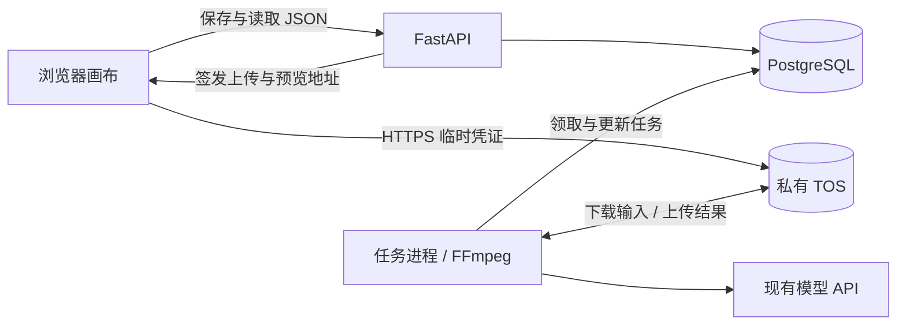

# PostgreSQL + TOS 设计（精简上线版）

日期：2026-09-13

状态更新（2026-09-14）：PostgreSQL 存储层、TOS SDK 适配器与本地对象模拟已接入现有应用，完成本地集成验收；未创建云资源、未迁移真实数据，真实 TOS 网络尚未验收。本文保留最初的设计目标，文中的“尚未实现”和建议接口描述属于设计时状态；实际功能、差异和启动步骤以[本地实现与验收](postgresql-tos-implementation.md)为准。
配套：[建表 SQL 草案](postgresql-tos-schema-draft.sql)；[上线计划](volcengine-cloud-launch-plan.md)。

## 1. 先确定的方案

保留现有 Python/FastAPI 和两种画布，第一版使用一个共享工作区 default。此次不引入注册、邮箱、逐用户权限或余额系统；进入工作区的使用者共用其中的数据，入口仍需认证。200 人是容量规划讨论，尚未确认是否 200 人同时在线，本文不保证该并发能力。

- PostgreSQL：画布、素材索引、任务、已有费用账本及必要的配置/历史记录。
- 私有 TOS：原始素材、生成结果、缩略图、工作流包和导出文件。
- ECS：运行应用与处理任务；磁盘只放程序、有上限的暂存文件和轮转日志。
- 先由 PostgreSQL 任务表协调任务，不强制增加 Redis。数据库和 TOS 就绪后，应用与任务进程可以逐步拆机。



## 2. 对应当前代码

| 已核对的位置 | 当前行为 | 改造方式 |
|---|---|---|
| app/services/canvas.py：save_canvas、load_canvas | 一张画布一个 JSON 文件，含 nodes、connections、viewport；保存时会导入账本日志 | 保持 API 返回结构，内部改为 PostgreSQL 事务 |
| app/services/assets.py：load_asset_library、make_asset_library_item | 素材库 JSON，素材复制到本地；保留各供应商 registrations | 素材库条目保留，文件地址关联独立的媒体记录 |
| app/services/media.py：output_file_from_url | 只把 /assets/、/output/ 转为本机路径 | 新增统一素材访问服务；本地路径仅由临时下载方法提供 |
| app/services/canvas_tasks.py | SQLite 保存 task_json、request_json、任务状态 | 原 ID、请求、供应商任务 ID 迁到 tasks，保留现有恢复语义 |
| app/services/canvas_ledger.py | 已有五张账本表，含别名去重、冲突、导入记录、版本 | 五表兼容迁移，保留历史金额、价格依据和去重关系 |

当前文件集合还包括 data/canvas_folders.json、asset_library.json、prompt_libraries.json、api_providers.json、conversations/、history.json 及维护状态等。迁移需逐类盘点，不能只搬 canvases/。仅核对文件名与代码结构，未展开用户素材或密钥内容。

## 3. PostgreSQL 表设计

采用 PostgreSQL 16，独立 schema：canvas_cloud。新表 ID 用 text，避免破坏旧的画布 ID、asset_xxx、canvas_vid_xxx。所有业务默认 workspace_id=default；这个字段是将来的数据归属接口，不代表已实现用户隔离。

| 表 | 保存什么 | 关键规则 |
|---|---|---|
| workspaces | 第一版只有共享工作区 | 后续可增加工作区，不必改 TOS 目录结构 |
| canvases | 标题、类型、节点文档 JSONB、revision、时间、回收站标记 | 保留节点及连接 ID；更新必须检查 revision |
| assets | 每个物理文件的 ID、TOS bucket/key/version、类型、大小、校验值和状态 | 一个文件一条；缩略图也是一条，通过 parent_asset_id 关联原件 |
| asset_aliases | 来源命名空间 + 旧相对路径 → 新媒体 ID | 同一来源旧路径只能对应一个媒体 ID；禁止只按文件名匹配 |
| canvas_assets | 画布引用哪些文件 | 随画布保存同事务更新；仅是引用索引，不能独自决定物理删除 |
| tasks | 输入、输出、模型、状态、上游任务 ID、幂等键、执行租约 | 请求重试不重复创建任务；抢占任务后及时提交事务 |
| workspace_documents | 文件夹、提示词库、素材目录、对话等既有 JSON 数据 | 按对象分行，使用 revision；不将所有历史堆在一行 |
| ledger_entries / aliases / conflicts / imports / versions | 已有费用账本五表 | 兼容迁移，不额外设计用户扣费体系 |

12 张表中，5 张是保留已有账本，不是新增商业化系统。

**画布先整体存 JSONB，不把每个节点拆成 SQL 行。** 这样保留前端结构，减少改造。document 包含 nodes、connections、viewport、folder_id、icon、color、pinned 和其他兼容字段；id/title/kind/revision/时间等列为权威值，API 组装时覆盖旧副本。logs 进入独立账本，不重复作为无限增长的画布正文。[PostgreSQL JSONB 文档](https://www.postgresql.org/docs/16/datatype-json.html)

素材库的“条目”与“文件”不同：两个目录条目可以引用同一媒体 ID，各自保留名称、分类和 registrations。workspace_documents 第一版按素材库、目录或单条目存储；返回旧接口需要的树形结构。conversations 按对话分行，长历史分页。维护开关放独立文档，监控指标进入日志/监控系统，不长期堆积到业务 JSON。

**现有费用与分账保留：** amount_micros 使用 bigint，原币种、估算标记和价格快照原样迁移，不用当天价格重新计算。账本别名、冲突和导入指纹一起迁移。账本历史可以关联已删除画布，因此不随画布级联删除。云平台分账是另一套数据来源，不由这些表自动生成。

### 保存画布

客户端读取时收到 revision。保存时必须带回该值，新接口缺少版本返回 400；旧客户端先通过适配层升级，不允许静默走“最后写入覆盖”。

```sql
UPDATE canvas_cloud.canvases
SET document = $3::jsonb, revision = revision + 1, updated_at = now()
WHERE workspace_id = $1 AND id = $2
  AND revision = $4 AND deleted_at IS NULL
RETURNING revision, updated_at;
```

事务中完成：版本更新 → 提取媒体引用 → 校验并按 ID 排序锁定素材记录 → 更新 canvas_assets → 提交。任一步失败全部回滚；更新零行时区分不存在/版本冲突，冲突返回 409 并保留客户端尚未保存的修改。后台回填生成结果也遵守同一版本规则，冲突后重新读最新画布合并，不能覆盖整张旧快照。

数据库普通时间统一 timestamptz，接口适配器输出原协议的毫秒；旧任务时间为秒，导入时按秒转换。账本草案保留原 bigint 毫秒，防止误乘/除 1000。updated_at、revision 和状态流转由应用事务维护，DDL 本身不代劳。

## 4. TOS 结构

建议两个私有桶，同地域部署，名称需全局唯一：

```text
infinite-canvas-prod-<唯一后缀>
  media/default/ast_<uuid>/original.png
  media/default/ast_<uuid>/original.mp4
  media/default/ast_<另一个uuid>/preview.webp
  media/default/ast_<另一个uuid>/workflow.zip
  staging/default/<upload_uuid>/source.bin

infinite-canvas-backup-<唯一后缀>
  migration/<batch_id>/manifest.json
  migration/<batch_id>/source-data/
  database/YYYY/MM/DD/<backup_id>.dump
```

每个派生文件也有独立 ast_ ID，parent_asset_id 指向原件，role 描述 preview/export 等用途。生成、裁剪和导出结果属于长期媒体，不能放自动过期的 staging/。对象 key 不包含用户输入的文件名；display_name 单独保存，重命名不搬对象。

- 主桶使用标准存储；开启版本控制，并记录对象 version ID。
- ECS 通过同地域内网 Endpoint 读写；浏览器和模型供应商使用公网 HTTPS 地址。
- 应用身份只访问指定桶/前缀；备份用独立权限，普通应用身份不能删除备份。
- 浏览器只拿临时凭证，不接触永久 AK/SK。CORS 限应用域名，按上传与预览开放方法。
- 数据库保存 bucket、region、key、version ID，不保存签名链接作为永久引用。
- 初版不跨用户做全局内容去重，sha256 用来核验迁移和对象内容。

官方接入：[Python 上传](https://www.volcengine.com/docs/6349/92800?lang=zh)、[Python 预签名](https://www.volcengine.com/docs/6349/135725?lang=zh)、[TOS 版本与生命周期能力](https://www.volcengine.com/product/tos)。

### 标识约定

```json
{
  "id": "保留原节点ID",
  "media_asset_id": "ast_新媒体ID",
  "url": "/api/media/ast_新媒体ID/content"
}
```

使用 media_asset_id 避免与已有供应商 asset_id 混淆。url 为稳定应用入口，浏览器访问时后端鉴权并跳转到临时签名地址；后端生成请求应直接调用素材服务，不能再绕公网下载自己的 API。

供应商的 registrations、project_name、asset_uri（例如 asset://…）保留在素材库条目中。TOS 文件上传成功不等于已经完成供应商素材注册、审核或获得相同权限，迁移不能把供应商 asset_uri 改成 TOS URL。

## 5. 上传、预览和媒体处理

### 上传

1. POST /api/media/uploads：访问认证、检查文件声明与全局上限；由后端生成媒体 ID、staging key、最终 key，记录 uploading 状态，签发受限上传凭证。
2. 浏览器上传到 staging/。大文件采用分片上传；客户端不能自行指定任意目标 key 或桶。
3. POST /api/media/uploads/{id}/complete：后端固定所接收的 staging version ID，检查实际大小和格式，计算/核验内容校验值，进入 verifying。不能只信客户端“上传成功”或自报哈希，也不把 ETag 当作通用文件哈希。
4. 后端从固定版本复制到仅服务端可写的最终 key，校验最终对象版本；同一确认请求重复到达时复用已有结果。
5. 数据库记录最终 version、大小、sha256、MIME 并标记 ready。未 ready 的文件不允许保存成可用引用或提交给模型。
6. staging 清理单独进行。文件复制成功但数据库提交失败时，通过已有记录和预定 key 对账重试，不重新生成一份业务记录。

签名上传凭证在到期前可能重复使用，因此不允许浏览器直接写 ready 对象；固定 staging 版本后，后续重传不能改变已经确认的原件。上传凭证过期时间依据文件大小配置；完成后超限校验不能代替上传策略中的大小约束，分片上传总量也需要服务端控制。

### 预览与模型参考图

- GET /api/media/{id}/content?variant=preview：验证共享入口权限及对象 ready 状态，返回短期签名 GET 跳转；响应不进入公共缓存。
- 页面只加载视区内缩略图，点击后加载原件；视频播放支持 Range。签名过期重新取地址，不保存到节点 JSON。
- 第三方模型获取参考素材使用公网签名地址，其有效期要覆盖供应商实际拉取窗口；不能照搬浏览器预览 TTL。若供应商要求自己的素材注册，继续走对应适配器。
- 签名链接在有效期内属于持有者凭证；退出应用不会即时撤销已经签发的链接。[预签名机制](https://www.volcengine.com/docs/6349/173954?lang=zh)

### 裁剪、导出与生成结果

新增素材服务接口（建议名，尚未实现）：

```python
resolve_media_ref(value)                 # 媒体ID、旧路径或受支持的供应商标识
get_browser_url(media_id, variant)       # 公网短期签名地址
get_provider_reference(media_id, provider)  # 按供应商规则转换
async with materialize(media_id) as path:   # 下载到受控工作目录
    ...                                  # FFmpeg等需要本地路径的操作
publish_result(task_id, local_path)      # 校验、TOS入库、返回稳定媒体ID
```

materialize 流式下载到 /var/lib/infinite-canvas/tmp/<task-id>/，校验允许的 bucket/key，限制大小、超时和全局临时空间；清理只操作该目录。初始全机重型媒体并发可设为 2，需以大视频压测调整。不要一次把整个视频读入内存；现有 ZIP 导出也需改成磁盘或流式打包。原始远程 URL 导入单独校验地址、跳转和网络目标，不能把任意用户 URL 当成可信内部素材。

生成成功必须先持久化输出到 TOS，再提交 assets + tasks + 必要账本变更。上游返回的临时结果 URL 不能成为最终唯一副本。网页拿到任务结果后可保存到画布；后台主动回填也必须检查画布版本。

## 6. 任务与扩容接口

状态：queued → running → submitting → polling → finalizing → succeeded。本地裁剪任务可从 running 直接进入 finalizing；错误进入 failed，提交结果不明确进入 needs_review。

按现有任务语义做映射，保留原 request/task JSON 的额外字段到 request 与 legacy_metadata；未识别的旧状态保留原值并映射到 needs_review，不强行重跑。

- (workspace_id, idempotency_key) 唯一；request_sha256 由服务端对剔除临时 URL、密钥后的规范请求计算。同键同请求返回旧任务，不同请求返回 409。
- 供应商账号用 provider_account_ref 标识，不存 AK/SK；上游任务 ID 连同 provider_id、账号引用保存。
- 每次领取产生新的 lease_token。心跳和结果写入都匹配 token 与未过期 lease_until；过期执行者不能修改数据库最终状态。
- PostgreSQL 的 SKIP LOCKED 可用于多个消费者领取队列任务；领取后立即提交，网络调用和 FFmpeg 不占用长事务。[PostgreSQL 16 SELECT](https://www.postgresql.org/docs/16/sql-select.html)

领取示例（$1 为任务进程标识）：

```sql
WITH candidate AS (
  SELECT id FROM canvas_cloud.tasks
  WHERE status IN ('queued','polling','finalizing')
    AND available_at <= now()
    AND (lease_until IS NULL OR lease_until < now())
  ORDER BY available_at, created_at, id
  FOR UPDATE SKIP LOCKED LIMIT 1
)
UPDATE canvas_cloud.tasks t
SET status = CASE WHEN t.status='queued' THEN 'running' ELSE t.status END,
    lease_owner=$1, lease_token=gen_random_uuid(),
    lease_until=now()+interval '90 seconds',
    attempt=attempt+1, updated_at=now()
FROM candidate c WHERE t.id=c.id
RETURNING t.*;
```

任务进程按 kind 领取自己支持的任务，示例为通用领取器。轮询完成一次后更新 available_at、清空租约，避免 busy loop；心跳建议每 30 秒续约，具体阈值可配置。attempt 统计领取次数，付费提交重试次数另记在元数据，不能把每次轮询当作一次付费重试。

恢复规则：
- 过期 running：确认尚未进入外部付费提交后可重新排队；本地处理允许重新执行，最终结果提交须幂等。
- 过期 submitting：进入 needs_review；优先用已存上游 ID/供应商幂等查询核对，不盲目重新提交。
- polling：重新查询已有上游任务，不创建新任务。
- finalizing：使用已存结果来源与输出媒体 ID 继续入库。重试沿用预先记录的输出槽位/媒体 ID；竞争写入采用唯一尝试对象 key，失败尝试留下的孤立文件交由对账处理。
- 缩容：任务机先停止领取，等待完成或交接恢复；网页连接可重连。租约只保护本地状态，不能保证外部 API 天然“恰好执行一次”。

初版单应用进程，数据库连接池建议上限 10；任务进程池上限 4，后续按全部进程总和预算数据库连接，预留管理和迁移连接。新增实例不能继续启动无协调的旧内存任务队列。跨实例实时消息可后续接 Redis，客户端仍以数据库查询结果为准。

## 7. 删除与备份

第一版默认关闭原始媒体的自动物理删除。用户删除画布只设置 deleted_at；移除素材库条目只解除目录引用，不立即删除 TOS 文件。

可自动清理：超过上传有效期并经过宽限期的失败 staging、已结束且无进程使用的本地临时目录、超过保留期的日志。清理时再次检查状态；TOS staging 当前版本、非当前版本、未完成分片需要分别配置策略，不能以为删除标记等于释放全部空间。

后续打开原件回收前，必须核对：全部画布（含回收站）、素材库、任务输入/输出、对话/历史、账本和保留的恢复快照。canvas_assets 不覆盖这些全部来源，因此当前不能据此“零引用即删”。引用创建与删除状态切换需使用同一素材行锁，防止检查完引用后又被使用。

建议数据库自动备份 + 每日独立导出，迁移前额外快照。备份初始保留 14 天；原件物理删除宽限期必须大于可恢复数据库历史窗口并留余量，不能出现数据库可恢复但素材已永久删除。版本控制不是独立备份。单独演练：恢复数据库、取回对应对象版本、打开旧画布并导出。

## 8. 迁移步骤

1. 清单与备份：画布、素材库、文件夹、提示词、对话、历史、任务 SQLite、账本五表，以及浏览器 localStorage 中需保留的内容。SQLite 使用一致性备份或停写后备份，不能只复制正在写入的主文件而遗漏 WAL。
2. 测试库建表，导入默认工作区。旧主键保留；旧任务找不到对应画布时 canvas_id 置空并保留原 ID 到 legacy_metadata；账本保留历史画布 ID。
3. 按完整源路径扫描文件，统一斜杠和受控 URL 解码，校验解析后仍在允许源目录内；生成持久化迁移 manifest，包括 source_namespace、原路径、目标媒体 ID/key、大小、哈希、状态和错误。
4. 流式上传并逐项验证，记录 asset_aliases；同一路径内容已变化时报告差异，不能静默复用。首次不按 basename 合并文件，也不把同内容素材的供应商注册信息合并。
5. 转换 classic/smart 画布、节点嵌套输出、工作流包、素材库和可变历史中的已知媒体字段。用结构化映射，不对所有文本做盲目替换。费用原始日志保留原文，展示时通过 alias 解析，避免改变去重指纹。
6. 导入 SQLite tasks 和五张账本表，按“秒/毫秒”分别转换。api_providers.json 仅迁非密钥定义，保留现有模型 ID、供应商项目归属、价格上下文；密钥另行部署。
7. /assets/ 与 /output/ 的兼容入口通过 alias 查 TOS，保留认证；云环境不再直接公开挂载整个旧目录。未知、过期的外部 URL 标记缺失，不伪造成功。供应商 asset:// 保持原语义。
8. 在测试环境验收上传、预览、参考图、裁剪、含资源工作流导出和历史费用，再停写本地做最后增量。只保留一个写入源，避免 JSON/SQLite 与 PostgreSQL 双写分叉。
9. 云端试用后保留本地备份。若云端已有新写入，回退先保全增量，不能直接退回陈旧本地文件。

迁移报告必须包含：各类记录数量、文件数量/大小/校验、缺失引用、冲突映射、账本按币种/已知与未知状态分组的金额核对。保留未知价格状态，不能把未知金额改成零后宣称总额一致。[TOS 迁移指南](https://www.volcengine.com/docs/6349/515825?lang=zh)

## 9. 建议模块与配置

实施时新增存储层，不在本次设计中直接替换运行代码：

- repositories/canvases、tasks、documents、ledger：数据库读写与事务。
- services/media_store：本地兼容解析、TOS 读写、签名、临时下载、上传确认。
- 现有 routers 保留响应协议，在适配层补 revision 和媒体标识。
- worker 入口独立，首版与 API 同机也可以单独重启。
- 数据库迁移工具后续纳入部署；数据库运行账号仅授予业务读写，建表账号独立。

建议新增配置名（当前尚未实现）：

```dotenv
DATABASE_URL=postgresql://<app-user>:<password>@<private-host>:5432/<database>
DATABASE_SCHEMA=canvas_cloud
DEFAULT_WORKSPACE_ID=default
TOS_REGION=cn-beijing
TOS_BUCKET=<private-media-bucket>
TOS_INTERNAL_ENDPOINT=<控制台提供的同地域内网Endpoint>
TOS_PUBLIC_ENDPOINT=<控制台提供的公网Endpoint>
TOS_BACKUP_BUCKET=<private-backup-bucket>
MEDIA_TEMP_DIR=/var/lib/infinite-canvas/tmp
MEDIA_TEMP_MAX_BYTES=107374182400
MEDIA_WORKER_CONCURRENCY=2
MEDIA_PHYSICAL_GC_ENABLED=false
```

TOS 凭证由实例身份或服务端受限环境文件提供，SDK 鉴权方式实施时验证。数据库使用验证服务端证书的 TLS 连接；现有 API/.env 与服务进程配置需明确统一加载顺序。不得将连接密码或模型密钥放入工作区 JSON、画布、任务请求、前端或日志。示例的 100 GiB 临时预算需小于实际工作盘可用空间，保留系统、日志和在途任务余量。

## 10. 实施顺序与验收

| 顺序 | 工作内容 | 验收 |
|---|---|---|
| A | 数据库仓库层与 JSON/SQLite 导入 | 两种画布、任务和原费用账本完整；版本冲突可识别 |
| B | TOS 素材服务与旧路径映射 | 新旧素材均可预览；重复确认不改原件；断点迁移可继续 |
| C | 参考图、裁剪、导出和任务处理 | 真实供应商能取素材；临时盘可控；进程中断能恢复或进入可处理状态 |
| D | 入口保护、备份恢复、切换 | 认证覆盖页面/API/实时连接；备份恢复后素材可用；只有一个写入入口 |

SQL 草案已在隔离 PGlite 0.5.8（嵌入式 PostgreSQL 18.3）通过 12 项基础检查：12 表创建、旧 ID、画布结构、ready 素材约束、对象 key 唯一、别名唯一、跨工作区引用约束、画布版本检查、任务幂等键、顺序领取不重复、旧租约提交被拒、历史账本金钱精度。

这不等于火山云 PostgreSQL 16 验证，也不是多连接并发/负载测试。实施阶段仍须在目标 PostgreSQL 16 验证 DDL、多个消费者竞争领取、保存/删除竞争、TOS 分片与签名过期、复制后断网恢复、真实媒体性能以及供应商调用。当前未连接任何云数据库或 Bucket。
